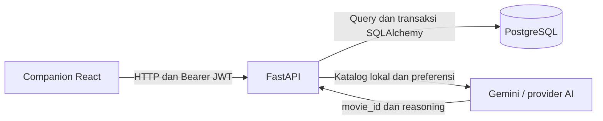
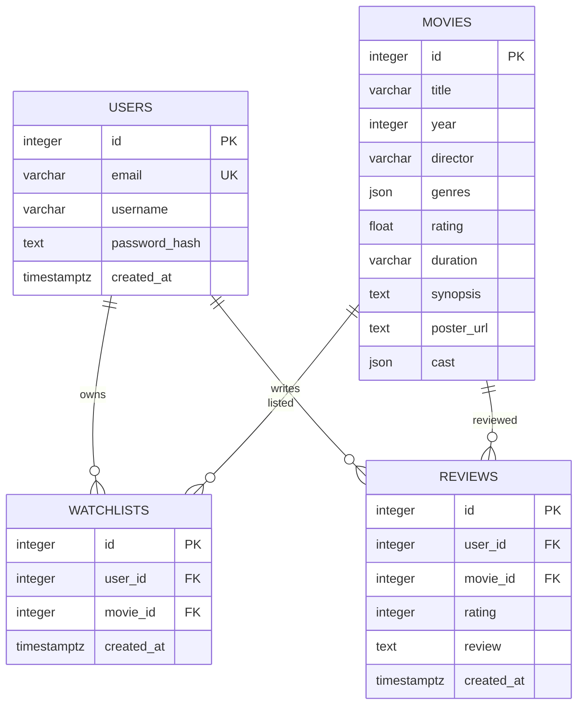

# FilmLog: Movie Watchlist & Review API

FilmLog adalah backend untuk menemukan film, menyimpan watchlist pribadi, mencatat tontonan beserta rating dan ulasan, serta meminta rekomendasi AI dari katalog awal 20 film. Proyek ini dibuat untuk Back-End Assignment Open Recruitment GDGoC UGM 2026/2027 dan dilengkapi companion frontend React.

**Navigasi:** [Setup lokal](#menjalankan-secara-lokal) · [Konfigurasi](#konfigurasi) · [Arsitektur](#arsitektur-dan-struktur-proyek) · [ERD](#database-dan-seeding) · [API](#api) · [AI grounding](#rekomendasi-ai-dan-grounding) · [Pengujian](#pengujian) · [Troubleshooting](#troubleshooting)

## Teknologi

| Bagian | Teknologi dan perannya |
| --- | --- |
| API | Python, FastAPI, dan Pydantic untuk routing serta validasi request/response |
| Database | PostgreSQL 17, SQLAlchemy untuk query/relasi, dan Alembic untuk migrasi |
| Autentikasi | Argon2 untuk hashing password dan PyJWT untuk Bearer token |
| Rekomendasi | Klien HTTPX dengan protokol Chat Completions; konfigurasi Gemini dijelaskan di bawah |
| Frontend | React 18, Vite 5, Tailwind CSS 3, dan Lucide React |
| Pengujian | pytest, Vitest, Testing Library, dan ESLint |

## Menjalankan secara lokal

### Prasyarat

- Python 3.14; lockfile backend disiapkan pada Python 3.14.6.
- Docker yang aktif dan Docker Compose v2, misalnya melalui Docker Desktop.
- Node.js 18 atau 20+ beserta npm untuk companion frontend. Versi frontend terkunci di `frontend/package-lock.json`.
- Kredensial Gemini jika ingin mencoba rekomendasi AI. Endpoint lain dapat dijalankan tanpa konfigurasi AI.

Docker Compose menjalankan PostgreSQL saja. Backend dan frontend dijalankan dari terminal terpisah.

### 1. Siapkan repository dan environment

```bash
git clone https://github.com/Fathzzzzz/gdgoc-BE.git
cd gdgoc-BE
cp .env.example .env
```

Edit `.env`: ganti `POSTGRES_PASSWORD`, samakan kredensial pada `DATABASE_URL`, dan isi `JWT_SECRET_KEY` dengan kunci acak minimal 32 karakter. Perintah berikut menghasilkan nilai yang dapat disalin sebagai kunci JWT:

```bash
python3 -c 'import secrets; print(secrets.token_hex(32))'
```

Variabel database dan JWT diperlukan saat backend dimulai. Konfigurasi AI dapat diisi kemudian melalui [panduan Gemini](#konfigurasi-gemini).

### 2. Jalankan database dan backend

Dari root repository:

```bash
docker compose up -d --wait
python3 -m venv backend/.venv
backend/.venv/bin/python -m pip install -r backend/requirements.lock.txt
cd backend
.venv/bin/alembic upgrade head
.venv/bin/python -m app.scripts.seed
.venv/bin/uvicorn app.main:app --host 127.0.0.1 --port 8000
```

| Layanan | Alamat lokal |
| --- | --- |
| API | [http://localhost:8000/api](http://localhost:8000/api) |
| Swagger UI | [http://localhost:8000/docs](http://localhost:8000/docs) |
| OpenAPI JSON | [http://localhost:8000/openapi.json](http://localhost:8000/openapi.json) |
| Health | [http://localhost:8000/health](http://localhost:8000/health) |

`GET /health` mengembalikan `{"status":"ok"}` untuk pemeriksaan proses; endpoint ini tidak menguji koneksi database. Pastikan katalog dapat dibaca setelah seed:

```bash
curl http://localhost:8000/api/movies
```

### 3. Jalankan companion frontend

Pada terminal kedua, mulai dari root repository:

```bash
cd frontend
npm ci
npm run dev
```

Buka [http://localhost:3000](http://localhost:3000). Frontend menyediakan Discover dengan pencarian/genre/shuffle, detail film, registrasi/login, watchlist, riwayat tontonan, rekomendasi AI, Settings, API Inspector, dan toast. Server Vite memakai port 3000 dengan `strictPort` agar origin sesuai dengan konfigurasi CORS backend.

### Menghentikan dan menjalankan kembali

Hentikan backend/frontend dengan `Ctrl+C` pada terminal masing-masing. Dari root repository, hentikan database dengan `docker compose stop` dan jalankan kembali dengan `docker compose up -d --wait`. Named volume menyimpan data saat container dibuat ulang; menghapus volume juga menghapus database lokal.

## Konfigurasi

Backend membaca `.env` di root repository, terlepas dari direktori terminal. Mulai ulang backend setelah mengubah konfigurasi karena settings disimpan dalam cache proses.

| Variabel | Kebutuhan / nilai bawaan | Fungsi |
| --- | --- | --- |
| `POSTGRES_USER` | Compose: `filmlog` | User saat inisialisasi PostgreSQL |
| `POSTGRES_PASSWORD` | Wajib diisi untuk Compose | Password PostgreSQL; samakan dengan `DATABASE_URL` |
| `POSTGRES_DB` | Compose: `filmlog` | Nama database awal |
| `POSTGRES_PORT` | Compose: `55432` | Port host menuju port container 5432 |
| `DATABASE_URL` | Wajib untuk backend | URL SQLAlchemy, contoh format ada di `.env.example` |
| `JWT_SECRET_KEY` | Wajib, minimal 32 karakter | Kunci penandatanganan token |
| `JWT_ALGORITHM` | `HS256` | Algoritma token |
| `ACCESS_TOKEN_EXPIRE_MINUTES` | `60`, harus positif | Masa berlaku token |
| `AI_BASE_URL` | Wajib untuk rekomendasi | Base URL provider Chat Completions |
| `AI_API_KEY` | Wajib untuk rekomendasi | Kredensial provider; hanya disimpan di backend |
| `AI_MODEL` | Wajib untuk rekomendasi | ID model yang tersedia pada provider |
| `AI_TIMEOUT_SECONDS` | `45`, harus positif | Batas waktu request HTTP provider |
| `CORS_ORIGINS` | Origin localhost dan 127.0.0.1 pada port 3000 | Array JSON origin frontend yang diizinkan |

`.env.example` memuat nilai contoh. File `.env`, virtual environment, dependency frontend, dan hasil build diabaikan Git. `requirements.txt` memuat rentang dependency langsung; `requirements.lock.txt` membekukan versi instalasi backend.

### Konfigurasi frontend

API Base URL dibaca dengan prioritas berikut:

1. Settings dalam aplikasi, disimpan sebagai `filmlog_api_url` di `localStorage`.
2. Environment Vite `VITE_API_BASE_URL`.
3. Default `http://localhost:8000/api`.

Untuk mengganti nilai saat development/build, dari root repository:

```bash
cp frontend/.env.example frontend/.env
```

Edit `VITE_API_BASE_URL`, misalnya menjadi `https://api.example.com/api`, lalu mulai ulang Vite atau build ulang. Pengaturan yang sebelumnya disimpan melalui Settings tetap memiliki prioritas tertinggi. API key AI dan rahasia database/JWT tidak ditempatkan pada variabel frontend.

Jika backend gagal diakses, Discover menampilkan label **data lokal (fallback)** dan memakai `frontend/src/data/movies.json` yang dibundel ke hasil build. Munculnya katalog fallback belum membuktikan koneksi API berhasil. Dataset root `data/movies.json` tetap dibutuhkan oleh seed dan pemilihan katalog rekomendasi backend.

## Arsitektur dan struktur proyek



```text
gdgoc-BE/
├── backend/
│   ├── app/
│   │   ├── core/             # konfigurasi, keamanan, dan helper error
│   │   ├── database/         # model, engine, dan sesi database
│   │   ├── modules/          # auth, movies, watchlist, reviews, recommendations
│   │   ├── scripts/seed.py   # impor dataset awal
│   │   ├── dependencies.py   # sesi database dan user dari JWT
│   │   └── main.py           # router, CORS, handler error, dan health
│   ├── migrations/           # revision Alembic
│   └── tests/                # pengujian API dan klien provider
├── frontend/
│   ├── src/
│   │   ├── pages/            # Discover, Watchlist, Watched, dan AI
│   │   ├── components/       # navbar, kartu, grid, modal, toast, inspector
│   │   ├── context/          # Auth, Api, Movies, Watchlist, Watched, Toast
│   │   ├── hooks/            # Escape pada modal dan penguncian scroll
│   │   ├── services/         # klien HTTP dan konfigurasi API
│   │   ├── lib/              # helper URL poster, array, dan shuffle
│   │   ├── data/             # katalog fallback
│   │   ├── styles/           # stylesheet Tailwind
│   │   ├── __tests__/        # test fitur dan komponen
│   │   └── test/             # setup dan helper pengujian
│   ├── index.html
│   └── vite.config.js
├── data/movies.json          # 20 film starter
├── scripts/                 # helper server statis lama
├── compose.yaml             # PostgreSQL lokal
├── vercel.json              # konfigurasi layanan deployment
├── .env.example
└── README.md
```

Modul backend dipisahkan berdasarkan fitur. Router menangani HTTP, schema memvalidasi input/output, service menangani aturan bisnis, dan repository movies menyediakan query katalog. Query review yang sederhana tetap berada di router. Model dikumpulkan dalam satu file agar relasi antarfitur mudah ditinjau.

Frontend memakai shared context untuk sesi, katalog, daftar pribadi, konfigurasi API, dan toast. Auth berada di atas context data pribadi agar perubahan sesi dapat membuang respons request yang sudah tidak relevan. `services/api.js` memusatkan header JWT, pembacaan API Base URL, error, dan log API Inspector.

## Database dan seeding



- Email user unik; username boleh sama.
- Watchlist memiliki unique constraint `(user_id, movie_id)` untuk mencegah duplikasi, termasuk request bersamaan. Indeks unik ini juga mendukung lookup per pemilik.
- Review memiliki check rating 1–5 dan indeks `(user_id, created_at)` untuk riwayat. Film yang sama boleh dicatat berulang; menonton tidak otomatis menghapus watchlist.
- Foreign key menjaga referensi user dan film. Penghapusan user menghapus catatan miliknya melalui cascade; film yang masih direferensikan tidak dapat dihapus. API penghapusan user/film belum disediakan.
- ID film mengikuti dataset secara eksplisit tanpa sequence. `genres` dan `cast` memakai JSON agar respons tetap berupa array. Rating katalog film terpisah dari rating ulasan user.

Migrasi mengatur skema; seed memasukkan katalog awal. Dari direktori `backend`:

```bash
.venv/bin/alembic upgrade head
.venv/bin/python -m app.scripts.seed
```

Seed memakai `ON CONFLICT (id) DO NOTHING`: aman dijalankan ulang tanpa menggandakan film atau menghapus data user. Film yang sudah ada tidak diperbarui otomatis. Untuk perubahan skema berikutnya, buat revision Alembic baru; revision yang sudah diterapkan tidak diedit ulang.

## API

Base URL lokal: `http://localhost:8000/api`. Body request menggunakan JSON. Dokumentasi schema lengkap tersedia melalui [Swagger UI](http://localhost:8000/docs) dan [OpenAPI](http://localhost:8000/openapi.json).

| Method | Path | Akses | Input utama | Sukses |
| --- | --- | --- | --- | --- |
| POST | `/auth/register` | Publik | `username`, `email`, `password` | 201 |
| POST | `/auth/login` | Publik | `email`, `password` | 200 |
| GET | `/movies` | Publik | Query opsional: `search`, `genre`, `shuffle` | 200 |
| GET | `/movies/{id}` | Publik | ID film pada path | 200 |
| GET | `/watchlist` | JWT | | 200 |
| POST | `/watchlist` | JWT | `movieId` | 201 |
| DELETE | `/watchlist/{movieId}` | JWT | ID film pada path | 204 |
| GET | `/watched` | JWT | | 200 |
| POST | `/watched` | JWT | `movieId`, `rating`, `review` | 201 |
| POST | `/movies/recommend` | Publik | `prompt` | 200 |

Login menghasilkan `{token, user}`; registrasi menghasilkan user tanpa password/hash. Daftar katalog, watchlist, dan riwayat berupa array. Penambahan watchlist menghasilkan `{data: {movie_id, movie, created_at}}`. Item riwayat memuat `id`, `movie_id`, `rating`, `review`, `created_at`, dan objek `movie`.

### Contoh alur autentikasi dan watchlist

```bash
curl -X POST http://localhost:8000/api/auth/register \
  -H 'Content-Type: application/json' \
  -d '{"username":"demo","email":"demo@example.com","password":"examplepass123"}'

curl -X POST http://localhost:8000/api/auth/login \
  -H 'Content-Type: application/json' \
  -d '{"email":"demo@example.com","password":"examplepass123"}'
```

Salin nilai `token` dari respons login, lalu gunakan pada header berikut. Registrasi email contoh yang sama untuk kedua kali menghasilkan 409.

```bash
FILMLOG_TOKEN='ganti-dengan-token-dari-login'
curl -X POST http://localhost:8000/api/watchlist \
  -H "Authorization: Bearer $FILMLOG_TOKEN" \
  -H 'Content-Type: application/json' \
  -d '{"movieId":1}'

curl http://localhost:8000/api/watchlist \
  -H "Authorization: Bearer $FILMLOG_TOKEN"
```

Pada Swagger UI, klik **Authorize** dan masukkan token untuk mencoba endpoint pribadi.

### Error response

```json
{
  "message": "Film sudah ada di watchlist.",
  "code": "WATCHLIST_DUPLICATE"
}
```

| Status | Kondisi |
| --- | --- |
| 400 | Input tidak valid; error validasi juga memuat array `fields` |
| 401 | Token hilang/tidak valid/kedaluwarsa atau kredensial login salah |
| 404 | Film atau entri watchlist milik user tidak ditemukan |
| 409 | Email atau entri watchlist duplikat |
| 500 | Kegagalan internal, dengan pesan generik |
| 502 | Output AI rusak, gagal validasi, atau memilih ID di luar katalog |
| 503 | Konfigurasi/katalog AI belum tersedia atau provider gagal melayani request |
| 504 | Timeout provider AI |

## Rekomendasi AI dan grounding

### Konfigurasi Gemini

Assignment meminta Gemini. Klien aplikasi menerima endpoint Chat Completions; Google menyediakan antarmuka kompatibel yang dijelaskan dalam [dokumentasi resmi Gemini](https://ai.google.dev/gemini-api/docs/openai). Contoh konfigurasi di `.env` root:

```dotenv
AI_BASE_URL=https://generativelanguage.googleapis.com/v1beta/openai
AI_API_KEY=ganti-dengan-api-key-gemini
AI_MODEL=ganti-dengan-id-model-gemini-yang-tersedia
AI_TIMEOUT_SECONDS=45
```

Gunakan key dari [Google AI Studio](https://aistudio.google.com/) dan ID model yang tersedia untuk akun tersebut. Nilai contoh harus diganti. Backend menambahkan `/chat/completions` ke base URL dan mengirim key melalui `Authorization: Bearer ...`; URL yang sudah berakhiran `/chat/completions` juga diterima.

Konfigurasi provider lain tetap dapat memakai variabel yang sama jika memenuhi kontrak request non-streaming dan respons teks `choices[0].message.content`. Tes otomatis memakai provider mock; contoh konfigurasi ini tidak menyatakan panggilan Gemini nyata sudah lulus pengujian.

### Alur grounding

1. Backend membaca ID katalog awal dari `data/movies.json`, lalu mengambil film yang tersedia pada database.
2. Katalog ringkas (ID, judul, genre, sinopsis, sutradara, dan tahun) dimasukkan ke system prompt. Preferensi user dikirim sebagai pesan terpisah.
3. Provider diminta memilih tepat satu film dan mengembalikan JSON `movie_id` serta `reasoning` berbahasa Indonesia.
4. Backend memvalidasi tipe ID/alasan dan memastikan ID termasuk katalog yang dikirim. Output di luar katalog ditolak dengan 502.

```bash
curl -X POST http://localhost:8000/api/movies/recommend \
  -H 'Content-Type: application/json' \
  -d '{"prompt":"Film sci-fi dengan misteri dan alur yang membuat berpikir"}'
```

Bentuk respons sukses berikut hanya ilustrasi; hasil sebenarnya bergantung pada provider:

```json
{
  "movie_id": 1,
  "reasoning": "Film ini sesuai dengan preferensi sci-fi dan misteri yang diminta."
}
```

Validasi memastikan ID berasal dari katalog, tetapi kualitas alasan tetap bergantung pada model. Batas timeout HTTP diatur melalui `AI_TIMEOUT_SECONDS`; kegagalan koneksi sebelum request terkirim dapat dicoba ulang hingga tiga attempt. Respons provider tidak diteruskan mentah kepada frontend.

## Keamanan dan validasi

- Password disimpan sebagai hash Argon2. Password tidak di-trim sebelum hashing; hash tidak masuk respons API.
- JWT memuat `sub`, `iat`, dan `exp`. Endpoint pribadi memvalidasi token dan mengambil identitas user dari token, bukan dari body request.
- Query data pribadi dibatasi berdasarkan pemilik. Entri milik user lain tidak dapat dibaca/dihapus dengan mengganti ID film.
- Email di-trim dan dinormalisasi menjadi huruf kecil. Username 3–50 karakter setelah trim; password 8–128 karakter; review 1–2000 karakter setelah trim; prompt 1–1000 karakter setelah trim. ID harus integer positif dan rating integer 1–5; boolean/pecahan ditolak.
- Input menerima `movieId` atau `movie_id`, `review` atau `opinion`, serta `prompt`, `query`, atau `description` untuk kompatibilitas payload companion. Field pendamping yang tidak dikenal diabaikan.
- CORS dibatasi ke origin yang dikonfigurasi. Logging request mencatat method, path, status, dan durasi tanpa body atau token.
- React merender teks API sebagai teks; `safeImageUrl` membatasi poster ke HTTP(S). Token sesi disimpan di `localStorage`. Logout/401 mengosongkan sesi browser dan state data pribadi; request dari sesi lama tidak digunakan untuk mengisi data akun berikutnya.

JWT belum memiliki refresh token atau revocation. Token yang disalin tetap berlaku sampai expiry walaupun user sudah logout. Status 403 tidak digunakan oleh endpoint saat ini; pencarian entri pribadi selalu memakai pemilik token dan menghasilkan 404 jika entri tidak ditemukan.

## Pengujian

### Backend

Gunakan database PostgreSQL lokal khusus pengembangan/pengujian yang sudah dimigrasi dan diisi 20 film. Dari direktori `backend`:

```bash
.venv/bin/pytest -q
```

Cakupan meliputi katalog, normalisasi email, login/JWT, isolasi dua akun, duplikasi watchlist termasuk request bersamaan, tontonan berulang, batas input, CORS, grounding rekomendasi, serta kegagalan/timeout provider.

Fixture API memakai transaksi luar dan savepoint yang di-rollback setelah test. Test concurrency memakai koneksi terpisah, melakukan commit data uji, lalu menghapus user uji melalui cleanup. Sequence ID dapat meningkat. Jangan arahkan pengujian ke database produksi. Panggilan AI disimulasikan dan tidak membuktikan kompatibilitas atau kualitas provider nyata.

### Frontend

Dari direktori `frontend`:

```bash
npm test
npm run lint
npm run build
```

Vitest dan Testing Library memakai mock `fetch`, sehingga tidak membutuhkan backend atau key AI. Cakupan meliputi sinkronisasi watchlist pada Discover, perubahan watchlist tanpa membuka ulang modal, data `localStorage` yang rusak, respons lama setelah sesi berubah, penanganan 401, rendering teks API, dan pembatasan URL poster. Gunakan `npm run test:watch` untuk mode watch.

## Build dan deployment

Untuk build companion frontend, dari direktori `frontend`:

```bash
npm run build
npm run preview
```

Hasil statis berada di `frontend/dist/`; preview memakai port 3000. Frontend dapat di-host terpisah dari backend. Atur `VITE_API_BASE_URL` sebelum build dan tambahkan origin frontend pada `CORS_ORIGINS` backend. Konfigurasi styling/build berada pada `tailwind.config.js`, `postcss.config.js`, dan `vite.config.js`; aturan lint berada pada `eslint.config.js` di folder frontend.

Untuk deployment backend, siapkan PostgreSQL yang dapat dijangkau layanan aplikasi, isi environment backend, jalankan migrasi dan seed terhadap database tujuan, lalu arahkan frontend ke alamat API. Repository menyertakan `vercel.json`; keberadaan konfigurasi tersebut belum membuktikan deployment berhasil. Deployment publik merupakan bonus assignment.

## Troubleshooting

| Gejala | Pemeriksaan |
| --- | --- |
| Docker tidak dapat dihubungi | Aktifkan Docker, lalu jalankan kembali `docker compose up -d --wait` dari root repository. |
| Login database gagal | Cocokkan `DATABASE_URL` dengan user/password/database dan port Compose. Mengubah `.env` tidak mengganti password role pada volume yang sudah diinisialisasi. |
| Katalog kosong atau tabel tidak ditemukan | Jalankan migrasi dan seed; periksa `GET /api/movies` secara langsung. |
| UI menampilkan data fallback atau CORS/ERR | Pastikan backend aktif, API Base URL benar, dan origin frontend terdaftar di `CORS_ORIGINS`. Periksa Settings yang tersimpan di browser. |
| Port frontend 3000 sudah dipakai | Hentikan proses yang memakai port tersebut. Jika port Vite diubah, sesuaikan juga origin CORS. |
| Rekomendasi menghasilkan 503 | Periksa key, base URL, ID model, ketersediaan katalog, dan akses/kuota provider. Mulai ulang backend setelah mengubah `.env`. |
| Rekomendasi menghasilkan 502 atau 504 | 502 berarti output provider gagal validasi; 504 berarti request provider timeout. Periksa konfigurasi dan layanan provider. |

## Demo dan atribusi

Penyerahan assignment mencakup repository publik dan video walkthrough 3–5 menit dengan akses Google Drive **Anyone with the link can view**. Video menjelaskan ERD, password hashing/validasi JWT/input, error handling, dan strategi grounding Gemini.

- Repository: [Fathzzzzz/gdgoc-BE](https://github.com/Fathzzzzz/gdgoc-BE).
- Video walkthrough: belum ditautkan.
- Deployment publik: belum ditautkan.
- Starter dan dataset: [bimoar07/movie-watchlist-starter](https://github.com/bimoar07/movie-watchlist-starter). Companion frontend pada proyek ini memakai React + Vite + Tailwind CSS.
