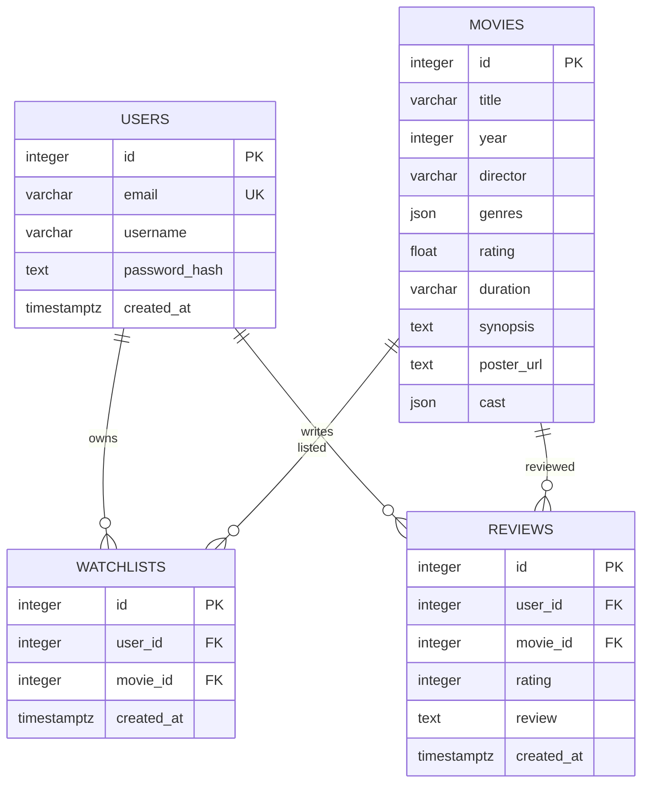

# ERD FilmLog

Watchlists unique (user_id,movie_id); indeks ini juga mendukung lookup per pemilik. Reviews memiliki indeks (user_id,created_at), check rating 1–5, dan boleh berulang. Movie ID eksplisit mengikuti dataset, tidak menggunakan sequence. Hapus user menghapus catatan miliknya lewat FK cascade; penghapusan film yang masih direferensikan ditolak. Endpoint penghapusan user/film tidak disediakan pada MVP.
