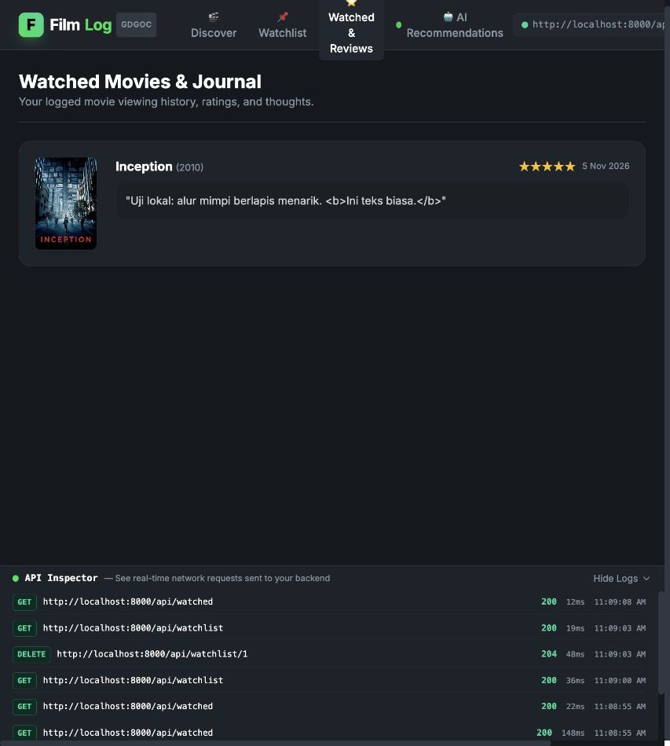

# Hasil verifikasi lokal
Tanggal: 5 November 2026. Lingkungan: macOS ARM64, Python 3.14.6, PostgreSQL 17 Docker, FastAPI/SQLAlchemy dan dependency sebagaimana requirements.lock.txt.

| Pemeriksaan | Hasil aktual |
|---|---|
| Docker PostgreSQL | Healthy; port host 127.0.0.1:55432 |
| Alembic upgrade head | Berhasil dari database baru |
| Alembic check | No new upgrade operations detected |
| Seeding berulang | 20 film, ID tetap; tidak menggandakan data |
| Seeding dengan data pengguna | Jumlah film/user/watchlist/review tidak berubah: 20/1/1/1 |
| Restart PostgreSQL | Data 20/1/1/1 tetap tersedia; browser dapat membaca lagi |
| pytest | 28 passed; PostgreSQL nyata dengan transaksi rollback; provider mock |
| Server frontend terbatas | frontend/data 200; .env, .git, backend dan traversal 404 |
| Backend restart | Login dan riwayat tetap berhasil melalui HTTP; hash Argon2 diperiksa |
| pip check | No broken requirements found |
| Node syntax check | app.js lolos |
| Node renderer test | Teks markup ulasan/alasan AI di-escape, javascript: URL ditolak |
| Browser companion | Register, login, katalog/detail, tambah/hapus watchlist dan review berhasil |
| Browser teks markup | Ulasan menampilkan <b> sebagai teks, bukan format HTML |
| Browser tanpa API key | Pesan 503 terbaca, tidak ada rekomendasi palsu |
| Request bersamaan | Dua penambahan watchlist: 201 dan 409, satu baris tersimpan |

## Cakupan tests
Katalog/detail/filter, bentuk array genre/cast, normalisasi email, email duplikat, kredensial salah, token hilang/rusak/expired, isolasi dua akun, kepemilikan dari token, film tidak ada, rating salah/boolean/pecahan, ulasan kosong, tontonan ulang, CORS allowed/denied, keluaran rekomendasi valid/ID salah/tipe salah/alasan kosong, timeout/network/quota/JSON rusak dan response hilang. Test HTTP provider memeriksa struktur request; ini bukan verifikasi kompatibilitas provider nyata.

## Batas verifikasi
- Pengujian provider OpenAI-compatible menggunakan simulasi. Untuk menguji provider sendiri, isi `AI_BASE_URL`, `AI_API_KEY`, dan `AI_MODEL`, mulai ulang backend, lalu coba `POST /api/movies/recommend`.
- Browser diperiksa pada browser bawaan aplikasi, bukan audit seluruh perangkat/browser atau aksesibilitas lengkap.
- Tidak dilakukan load test, pentest, deployment publik atau rekaman video.
- Snapshot diambil setelah watchlist demo dihapus; riwayat demo tetap ada. Akun ini hanya data demonstrasi lokal, bukan akun produksi.
- tests memakai transaksi rollback pada database lokal; perubahan sequence ID normal dan tidak menunjukkan data pengguna hilang.
